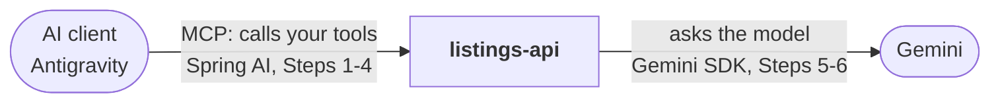

# TP IA primer — MCP, Spring AI, the Gemini SDK

Background for [`../exercise.md`](../exercise.md): what MCP is, the two
libraries of the TP, and what not to do. Read it once before Step 1.

## What is MCP?

**MCP is an open protocol that lets an AI application call your program through
standard "tools".** Your Spring Boot app is the **server**; an AI app
(**Antigravity**, or any other MCP client) is the **client**.

| Concept | What it is here |
|---|---|
| **Server** | your `listings-api` (TP1) exposing MCP (revision **2026-07-28**) over HTTP |
| **Tool** | one Java method (`get_listing`, `list_listings`, `change_listing_price`) an LLM can call |
| **Transport** | one endpoint, `POST /mcp`, carrying JSON-RPC (`server/discover`, `tools/list`, `tools/call`); **stateless**: no session, each request names its method (`Mcp-Method` header) and its protocol version (`Mcp-Protocol-Version`, `_meta`) |
| **Client** | an AI app that lists your tools and calls them in natural language |

You are **not** writing a chatbot and you are **not** hosting an LLM. You are
**exposing your existing business code as callable tools** (Steps 1-4) and, in
the bonuses, **calling an LLM from your code** (Steps 5-6). That split is the
whole idea of the day.

## The two libraries (versions pinned — do not guess)

| Library | Artifact · version | Used by |
|---|---|---|
| Spring AI (Boot 4 line) | `org.springframework.ai:spring-ai-starter-mcp-server-webmvc:**2.1.0-RC2**` (`protocol: MODERN`) | Steps 1-4 (the MCP server + tools) |
| Google Gen AI SDK | `com.google.genai:google-genai:**1.78.0**` | Steps 5-6 (calling Gemini) |

**Why two different things** — the calls go in opposite directions:

> Spring AI **2.1** targets the Boot 4
> line and works with TP1's Boot **4.1.1**; it is the first line with the
> stateless 2026-07-28 revision of MCP that Antigravity speaks (2.0.x only has
> the older session-based transports).

## What NOT to do

- **Never** put an API key (Gemini or any) in code, `application.yml`, the repo, or logs.
- **Never** open the MCP route to the world — it **keeps Basic auth**.
- **Never** bypass TP1 ownership from a tool — a **403** for a non-owner is the *correct* outcome.
- **Never** let generated text overrule DB facts (price, category) — the model
  *describes*, the DB *decides*.
