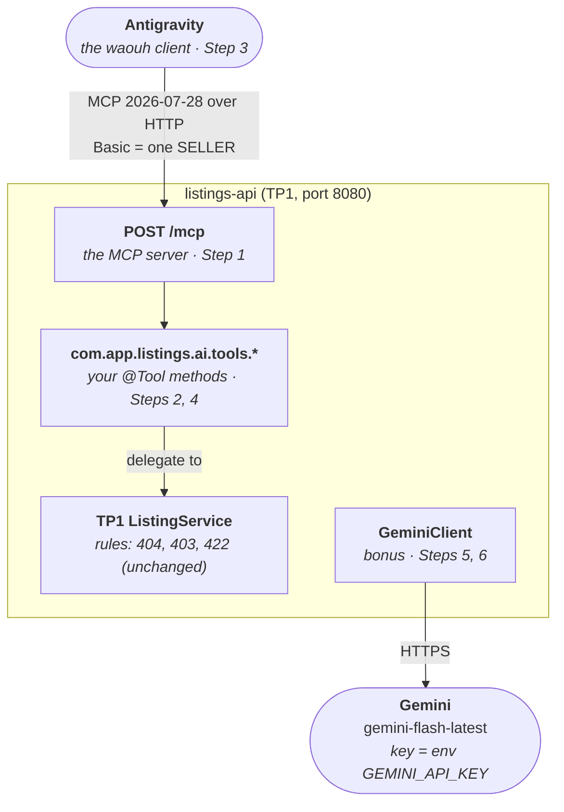
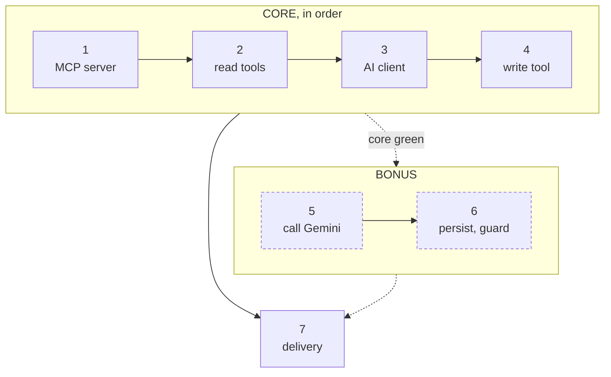
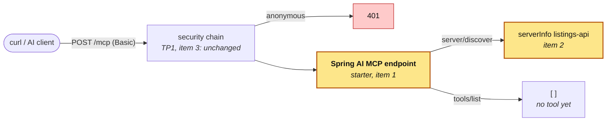
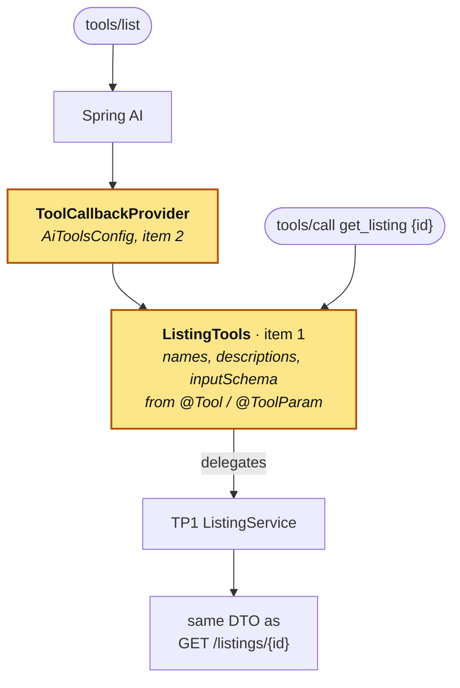
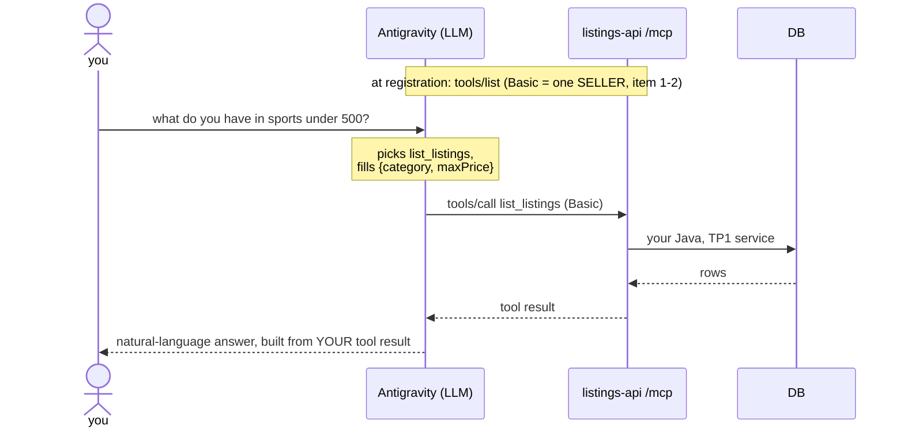
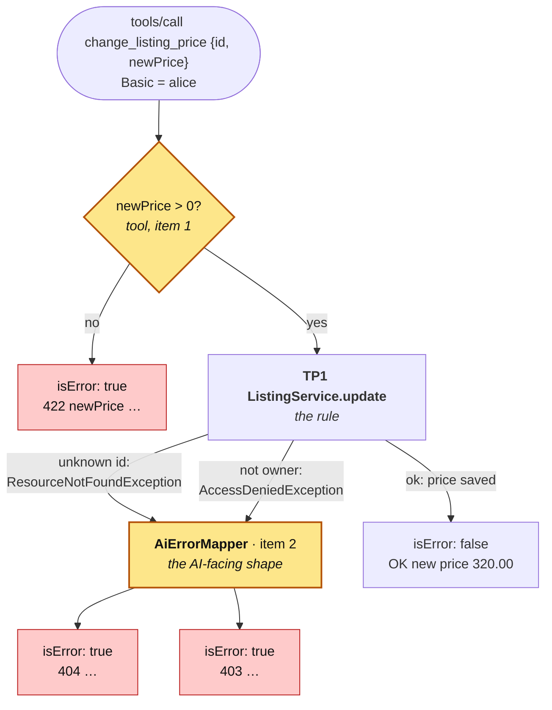
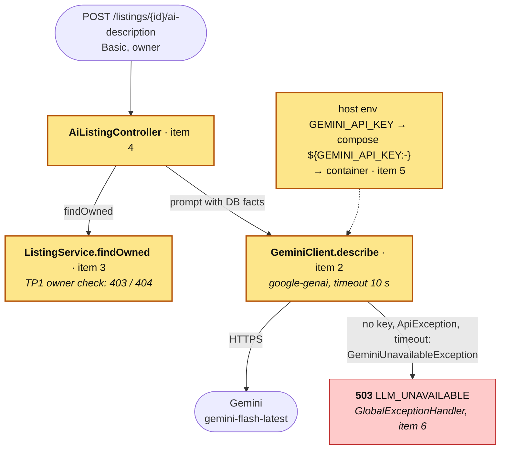
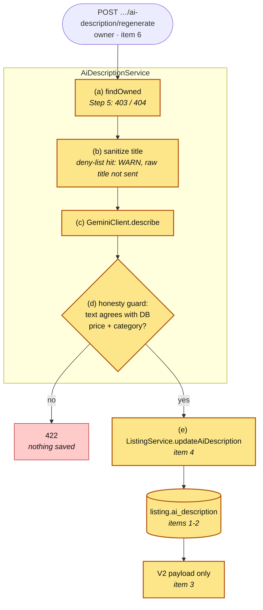

# TP IA — MCP server + Gemini in the Spring Boot API

## Overview

This is a **follow-up** to the Spring Boot TP (TP1, `../springboot/`). We reuse
the **TP1 listings API** — unchanged domain, unchanged port (8080) — and add an
**AI layer** with two small skills:

1. **The API becomes an MCP server.** Its business methods are exposed as
   *tools* over the **Model Context Protocol (MCP)**, so an **AI client** can
   call your Java and report back in **natural language** (the "waouh").
2. **We flip the roles.** The API itself calls the **Gemini** model (free
   Google AI Studio key, `google-genai` SDK) to **generate content** for a
   listing.

There is **no new Docker stack and no port change**: the MCP endpoint is an
extra route on the TP1 app (8080); the only new component on the student
machine is the **AI client** you point at `http://localhost:8080/mcp`.

**Validation method (the contract):** each step's **`Expected behavior`** is
the contract. Its **`Verify`** section (Step 7: **`Final checks`**) is the
definition of done: **observable data**, not a Java test.

| Level | What you assert | How |
|---|---|---|
| **Handshake** | the MCP server is up **and** keeps auth | `curl` `server/discover` on `POST /mcp` — [`docs/verification.md` §1](docs/verification.md) |
| **Tools** | `tools/list` returns your tools with a readable `description` + `inputSchema` | [`docs/verification.md` §1](docs/verification.md) |
| **Call** | `tools/call` runs **your Java** and returns the DB data | [`docs/verification.md` §2-3](docs/verification.md) |
| **Client** | the AI client lists **your** tools and answers in natural language | the **client transcript** (Step 3) |
| **LLM** (bonus) | the API returns Gemini text for a listing | `curl POST /listings/{id}/ai-description` (Step 5) |

You may not *pass* a step by only "the client said something": you show
the **raw MCP call result** (or a `GET` readback) **and** a client transcript
that agrees with it.

The **code** lives in **your copy of `../springboot`** (a new
`com.app.listings.ai` package); **this repo** (`IA/`) only owns the statement,
the client config, and the verification curls.

New to MCP or to Spring AI? Read [`docs/primer.md`](docs/primer.md) first
(5 minutes).

> **Prerequisite: TP1 is done and green.** The TP1 API passes its core
> checklists (register, CRUD, ownership 401/403/404, `?version=V1|V2`) and runs
> on port 8080. Finish TP1 first — this TP only adds an AI layer on top of it.
>
> This is **one of four alternatives** for the second TP ([Keycloak](../keycloak/),
> [Monitoring](../monitoring/), IA, [Messaging](../messaging/)). They all start
> the same base `listings-api`, so run **one** at a time.

### How to read a step

| Section | What it gives you |
|---|---|
| **Outcome** | the observable result |
| **Why this step** | the concept taught and the real problem it solves |
| **How it fits** | who calls whom (AI client, MCP endpoint, your tools, TP1 service, Gemini) and which part you change |
| **Build it** | the changes, in order; the `→` line under each item says what breaks without it |
| **Checkpoint** | a quick call to confirm a group works before starting the next one |
| **Expected behavior** | the contract: statuses, tool results, rules |
| **Verify** | the definition of done: the [`docs/verification.md`](docs/verification.md) section to run, plus the checks the contract cannot show |
| **If you are stuck** | folded: open it only when blocked; pointers to the class, annotation, or documentation, never the full code |

---

## Domain & data model (this TP)

The **business domain does not change** from TP1 (actors, the `Listing` entity,
ownership, `active=false`, V1/V2 visibility). What **changes** is only the AI
layer:

| Concern | TP1 | This TP |
|---|---|---|
| How you read/write listings | REST endpoints | **+ MCP tools** (same service, a new `ai` package) |
| Who can call the write path | HTTP Basic SELLER | **same** — the AI client also authenticates as a SELLER; **TP1 ownership (403) still applies inside the tool** |
| Who generates listing text | (none) | **Gemini**, called by your Java (bonus) |
| What the "AI" decides | — | nothing — it *requests*; **your code decides** (404/403/422) |

> **Key idea for the day:** exposing your API to an LLM does **not** remove any
> security or validation. The model picks a tool and fills the arguments;
> **your Java still enforces 404 / 403 / 422.** If the model *requests* a change
> to a listing it does not own, it gets a clean `403` — not a crash, not a
> success.

### The pieces of this TP, in one picture

The AI client calls your API (MCP); in the bonuses, your API calls an AI
(Gemini). In the step diagrams, the highlighted boxes are the parts you write
in that step, red boxes are error answers.

---

## Scope

| Track | Steps | Target (2nd-session binôme) |
|---|---|---|
| **Core** (required — the waouh must work) | 1 · 2 · 3 · 4 | ~3h30 |
| **Bonus** (start only when the core checklists are green) | 5 (Gemini text generation) · 6 (persist the text + harden the prompt) | ~2h |
| **Delivery** | 7 (final integration) | ~0h30 |

If the core is not green, do not start the bonuses.

---

## Conventions

- **Service name** (used in `serverInfo.name`, logs): `listings-api`.
- **Port:** API + MCP on **8080** (unchanged from TP1). Postgres **5435**.
- **MCP protocol:** revision **2026-07-28** over HTTP, one endpoint
  `POST http://localhost:8080/mcp` (`spring.ai.mcp.server.protocol: MODERN`,
  Spring AI **2.1**). Stateless: no `initialize`, no session; each request
  carries `Mcp-Protocol-Version`, `Mcp-Method` (and `Mcp-Name` for a tool
  call) and a `_meta` with the protocol version. Not the session-based
  `STREAMABLE` transport (Spring AI 2.0): Antigravity CLI speaks 2026-07-28
  and never finishes connecting to it.
- **Auth on the MCP route:** **HTTP Basic** (TP1's default-deny is **preserved**).
  The AI client authenticates as a **SELLER**; anonymous → **401**.
- **Test accounts** (TP1, password `secret123`): `alice@test.org` owns
  listing `1`; `bob@test.org` is another SELLER (non-owner of listing `1`).
- **Tool names (fixed — do not rename):** `get_listing`, `list_listings` (read
  tools, Step 2) and `change_listing_price` (write tool, Step 4). Set them with
  the `name` attribute of `@Tool`: without it, the tool is named after the Java
  method (`listListings`).
- **Category values (TP1, 9):** `ELECTRONICS`, `FURNITURE`, `CLOTHING`, `BOOKS`,
  `VEHICLES`, `SPORTS`, `HOUSEHOLD`, `GARDEN`, `OTHER`.
- **Gemini model** (bonus): `gemini-flash-latest`, Google's alias for the
  current Flash model (a fixed version such as `gemini-2.0-flash` is retired
  after a while; the alias is not). Configurable (`listings.ai.model`,
  `LISTINGS_AI_MODEL` in the compose): when it answers *"high demand"* or
  times out, use `gemini-flash-lite-latest`.
- **The key** is the **environment variable `GEMINI_API_KEY`** only — never in
  code, `application.yml`, the repo, or the git history. The base compose
  passes it through from the host (`${GEMINI_API_KEY:-}`), it does not store it.
- **Error JSON:** the TP1 error body shape is **unchanged**. MCP **tool
  errors** are tool results with `isError: true` whose text **starts with the
  HTTP status** ([Appendix E](#appendix-e--status-codes-and-tool-results), Step 4).
- **Rebuild after every Java change:** `cd "$TP1_DIR" && docker compose up -d
  --build listings-api` (the container runs the image built earlier).

---

## Step 1 — Bring up the MCP server   CORE

**Outcome** — Your TP1 API **is an MCP server**: `POST /mcp` answers
`server/discover` with `serverInfo.name = listings-api`, **keeps HTTP Basic
auth** (anonymous → 401), and `tools/list` answers (empty for now). Raw `curl` is
enough; the AI client comes in Step 3.

**Why this step** — MCP is a standard protocol: once your app speaks it, any
MCP client can discover and call it, with no client-specific code. The
transport is plain HTTP on the same port, so TP1's security chain applies
unchanged.

### How it fits

### Build it

1. **Add** the MCP server dependency to `pom.xml` —
   `org.springframework.ai:spring-ai-starter-mcp-server-webmvc` (the block is
   in **README §0**).
   → It brings the MCP endpoint and the auto-configuration that publishes
   your tools; without it, nothing answers on `/mcp`.
2. **Add** the `spring.ai.mcp.server` block to `application.yml` —
   `name: listings-api`, `protocol: MODERN` (README §0), **under the existing
   `spring:` key**.
   → The default (`STREAMABLE`) is the session-based revision of MCP, which
   Antigravity CLI does not complete; `MODERN` is the stateless 2026-07-28
   revision it speaks. The `name` is what the client shows in `serverInfo`.
   A second top-level `spring:` at the end of the file stops the app
   (`found duplicate key spring`).
3. **Check** `SecurityConfig` — `/mcp` falls under `anyRequest().authenticated()`,
   so it **keeps Basic auth** (do **not** permit it).
   → The tools act on behalf of a seller: an open endpoint would let anyone
   change prices through an AI client.

### Expected behavior
- **Anonymous** `POST /mcp` → **401** (the route keeps Basic auth; it is **not**
  opened to the world).
- `server/discover` with a SELLER Basic credential → **200**, a JSON-RPC
  `result` with `supportedVersions` = `["2026-07-28"]` and
  `serverInfo.name = listings-api` (in `_meta`). No session id: every next
  request stands alone.
- `tools/list` → an **empty** list (Step 2 adds tools).

### Verify

- [ ] [`docs/verification.md` §1](docs/verification.md): every result matches *Expected behavior*

<strong>If you are stuck</strong>

- Paste the dependency + the `application.yml` block from **README → "0) Required base edit"** (the *what/why* is in **Appendix A**).
- `/mcp` is the default endpoint (`spring.ai.mcp.server.modern.mcp-endpoint`) — do **not** declare a controller for it.
- `400 Missing required header: Mcp-Method`: every request names its method in the `Mcp-Method` header (plus `Mcp-Name` for `tools/call`), sends `Mcp-Protocol-Version: 2026-07-28` and `Accept: application/json, text/event-stream`. The helpers of [`docs/verification.md` §0](docs/verification.md) do it for you.
- An old `initialize` answering 400 is normal: the 2026-07-28 revision has no handshake session; clients start with `server/discover`.
- The startup log line `Registered modern tools: N` counts the published tools. Reference: <https://docs.spring.io/spring-ai/reference/2.1/api/mcp/mcp-server-boot-starter-docs.html>

---

## Step 2 — Expose two read tools   CORE

**Outcome** — Two read tools (`get_listing`, `list_listings`) appear in
`tools/list`, each with a **non-trivial description** and an
**`inputSchema`**. They **delegate to TP1's `ListingService`** (no new DB
access) and their `tools/call` result **matches** the equivalent `curl GET`
field-for-field.

**Why this step** — A tool is a method plus a **description**: the LLM never
sees your code, only the name, the description, and the parameter schema. The
description is what makes it choose the right tool, so it is part of the
contract, not a comment.

### How it fits

### Build it

1. **Create** `com.app.listings.ai.tools.ListingTools` — a `@Component` with
   **two public methods**, one per tool. Each method carries
   `@Tool(name = "…", description = "…")` and each parameter carries
   `@ToolParam(description = "…")` (`required = false` for the optional
   filters). The body **delegates to TP1's `ListingService`** (no SQL, no
   duplicated rule).
   → Without `name`, the tool takes the Java method name (`listListings`) and
   breaks the fixed naming. Delegating to the service is what keeps the
   visibility rules (hidden listings, V1 fields) identical to the REST API.
2. **Create** `com.app.listings.ai.tools.AiToolsConfig` — a `@Configuration`
   declaring **one `ToolCallbackProvider`** bean built from `ListingTools`.
   → Spring AI publishes the tools of `ToolCallbackProvider` beans; a
   `@Tool` method that no provider references is invisible to clients.
3. **Keep the signatures flat & small** — `Long id`, `String category`,
   `BigDecimal maxPrice`; a tool is a *method*, not an endpoint (no
   `HttpServletRequest`, no HTTP DTO in the signature — you may **return** a
   DTO).
   → The parameters become the JSON schema the LLM fills in: simple types
   give a schema it fills correctly.

### Expected behavior
- `tools/list` returns **2 tools**: `get_listing` (arg: `id`, required) and
  `list_listings` (optional args: `category`, `maxPrice`).
- Each tool has a **`description`** an LLM can use to decide when to call it
  (e.g. *"Look up one listing by its id."*) and an `inputSchema` with each
  parameter described.
- `tools/call get_listing {id: 1}` returns **the same data** as
  `GET /listings/1` (field-for-field).
- `tools/call list_listings {category:"SPORTS", maxPrice:500}` returns **only**
  the matching rows (same set of ids as the REST endpoint).

### Verify

- [ ] [`docs/verification.md` §2](docs/verification.md): every result matches *Expected behavior*
- [ ] `grep -n "listingService\.\|listingRepository\." "$TP1_DIR/src/main/java/com/app/listings/ai/tools/ListingTools.java"` — the tools **delegate to TP1's service** (no direct SQL bypass)

<strong>If you are stuck</strong>

- `@Tool` and `@ToolParam` live in **`org.springframework.ai.tool.annotation`** (pulled by the starter).
- The provider bean: `org.springframework.ai.tool.ToolCallbackProvider`, built with `org.springframework.ai.tool.method.MethodToolCallbackProvider.builder()`. The startup log line `Registered modern tools: N` counts them.
- Spring AI serializes a tool result with **its own** Jackson mapper: TP1's `spring.jackson.default-property-inclusion: non_null` does not apply, so a `null` field (e.g. `"description": null`) appears where `GET /listings/{id}` omits it. For a field-for-field match, put `@JsonInclude(JsonInclude.Include.NON_NULL)` on the DTO you return.
- Inside a tool, `SecurityContextHolder` holds the Basic caller (the tool runs on the request thread): the same way TP1's controllers find the caller works here.
- Full raw `curl`s for `tools/list` + `tools/call`: [`docs/verification.md` §2](docs/verification.md). Reference: <https://docs.spring.io/spring-ai/reference/2.1/api/tools.html>

---

## Step 3 — Connect the AI client and "waouh" it   CORE

**Outcome** — An MCP client (Antigravity, or any client speaking MCP 2026-07-28) is
**registered against your server**, carries the **SELLER Basic header**, lists
**your two tools** (not a built-in), and answers plain-English read questions
with data that **matches a raw `curl GET /listings/{id}`**. This is the
**waouh** — the moment you see your Java run end-to-end from an AI client.

**Why this step** — This is what MCP is for: you wrote no prompt and no
chatbot, yet a general-purpose AI client now uses your business code. It also
shows the limit: the client decides *which* tool to call, your Java decides
*what* happens.

### How it fits

### Build it

1. **Grab** the client config from
   [`client/mcp-client.json`](client/mcp-client.json) (see
   [`client/README.md`](client/README.md) for other clients). **Keep** the
   `Authorization: Basic …` header — the client authenticates as **one
   specific SELLER** (a TP1 account).
   → Without the header the client gets 401 and lists nothing; with it,
   every tool call runs as that seller, which is what Step 4's ownership
   check relies on.
2. **Register** the server in the client's MCP settings (Antigravity:
   `mcp_config.json`, via the *MCP Servers* panel).
   → The client discovers the tools at registration (`tools/list`); that is
   the first thing to check when no tool shows up.
3. **Read-prompt only** for this step — writes are Step 4.
   → A write that fails now could come from Step 4's missing tool rather
   than from the client setup.
4. **Capture the transcript** (screenshot or markdown) next to a side-by-side
   `curl GET /listings/{id}` for the team README — that is the evidence.
   → The side-by-side `curl` proves the values come from your database and
   were not invented by the model.

### Expected behavior
- The client is **registered** against `http://localhost:8080/mcp`, carries a
  SELLER Basic header, and the handshake succeeds.
- The client's tool list shows **your two tools** (not a built-in tool).
- A read prompt (e.g. *"what do you have in sports under 500?"*) results in
  **your Java running** and a natural-language answer.
- Every data value in the answer **matches** a side-by-side
  `curl GET /listings/{id}` — nothing is invented by the client.
- A client **without** the Basic header cannot even list tools (handshake 401).

### Verify (this step is the *waouh*)

- [ ] [`docs/verification.md` §4](docs/verification.md): the client transcript (in the team README, next to a raw `curl`) shows every line of *Expected behavior*
- [ ] The tool is **chosen** by the client, not hardcoded into the prompt (change the question; the client should still pick the right tool)

<strong>If you are stuck</strong>

- Antigravity uses `serverUrl` (`http://localhost:8080/mcp`) and `headers` (app: `mcp_config.json`; CLI: `agy mcp add --header "Authorization: Basic …" listings http://localhost:8080/mcp`). A server left on `STREAMABLE` stays at `initializing...` forever (Step 1, item 2). Reference: <https://antigravity.google/docs/mcp>
- `failed to construct executor: plan model not specified` in `agy`: the CLI could not fetch its model list (often a DNS hiccup in WSL); start it with `agy --model <a name from agy models>`.
- **Stay read-only** in this step — writes are Step 4.
- If the client shows **no tools**, replay Step 1's `server/discover` + `tools/list` with `curl` and the **same** Basic header as the client.
- To prove **your** Java runs (not a built-in), ask the client for a field you control (e.g. the exact price) and compare to a **side-by-side `curl GET /listings/{id}`** in a terminal.

---

## Step 4 — One write tool that respects ownership   CORE

**Outcome** — A **third tool**, `change_listing_price {id, newPrice}`, appears
in `tools/list`. It **delegates** to TP1's write path (owner check +
validation) and reports business failures as **tool errors whose text starts
with the HTTP status** — `404` for unknown, `403` for non-owner, `422 newPrice`
for a bad price — and the **DB is never mutated** on the failure paths.

**Why this step** — Giving an AI write access is where it becomes risky. The
safety does not come from the prompt or the model: it comes from the same
service rules as the REST API, applied to the identity of the caller, whatever
the model asks.

### How it fits

The service keeps the **rule** (it throws TP1's exceptions); the tool gives
the failure an **AI-facing shape** (a status-prefixed message):

### Build it

1. **Add** a third method to `com.app.listings.ai.tools.ListingTools`:
   `@Tool(name = "change_listing_price", …)` with parameters `Long id` and
   `BigDecimal newPrice`. The body:
   - **validates** `newPrice > 0` first;
   - updates the price through **TP1's `ListingService`** (so the TP1
     ownership check runs, for the Basic caller);
   - delegates the **persistence** to TP1 (no direct SQL against `listing`).

   → Calling the service, not the repository, is what keeps the 403: the
   owner check lives there.
2. **Add** a helper `com.app.listings.ai.tools.AiErrorMapper` that turns TP1's
   exceptions into an exception whose **message** starts with the status
   (`404 …`, `403 …`, `422 newPrice …`), and use it in a `catch` in the tool.
   → Spring AI already turns any exception into `isError: true` with the
   message as text; without the mapper, the text is TP1's raw message and the
   LLM cannot tell a missing listing from a forbidden one.
3. **Run** the four Verify cases (owner / non-owner / unknown / bad price).
   → Each case exercises a different branch; the failure branches are the
   point of the step.

### Expected behavior
The **full matrix** of this TP (one table, here, not duplicated per step):

| Caller (Basic cred) | `get_listing {id}` | `list_listings` | `change_listing_price` **own** | `change_listing_price` **other** | `change_listing_price` **unknown** | `change_listing_price newPrice<=0` |
|---|---|---|---|---|---|---|
| **Anonymous** | **401** | **401** | **401** | **401** | **401** | **401** |
| **SELLER (owner)** | 200 + body | 200 + list | **OK** + new price persisted in DB | — | **404** (tool error) | **422 `newPrice`** (tool error) |
| **SELLER (non-owner)** | 200 (public fields) | 200 | — | **403** (tool error) | **404** (tool error) | **422 `newPrice`** (tool error) |

Additional rules:
- Owner write: the **new** price is persisted (verify with a fresh `curl
  GET /listings/{id}`).
- Every failure branch of the *How it fits* diagram: `isError: true`, text
  **starting with** the status (e.g. `404 Listing not found: id=99999`), and
  the DB is **unchanged** (TP1 ownership is **not** bypassed).

### Verify

- [ ] [`docs/verification.md` §3](docs/verification.md) (owner / non-owner / unknown / bad price): every result matches *Expected behavior*
- [ ] `grep -n "AccessDeniedException\|ResourceNotFoundException" "$TP1_DIR/src/main/java/com/app/listings/ai/tools/"*.java` — both are caught and mapped

<strong>If you are stuck</strong>

- A tool returns normally on success (any object, serialized as text) and **throws** on failure: the thrown exception's message becomes the error text.
- The default result converter JSON-encodes every result, a `String` included: `"OK new price…"` reaches the model **with** its quotes. `@Tool(resultConverter = …)` with a small `ToolCallResultConverter` that returns a `String` as is fixes it.
- TP1's exceptions: `org.springframework.security.access.AccessDeniedException` (403) and your `ResourceNotFoundException` (404). Reuse them, do not invent new ones in the service.
- Test the 403 with `bob@test.org` as the Basic credential on alice's listing.
- Full raw `curl`s for all four cases: [`docs/verification.md` §3](docs/verification.md).

---

## Step 5 — Flip roles: call Gemini from the API   BONUS

**Outcome** — A new REST endpoint `POST /listings/{id}/ai-description` (owner
only) returns a **200** with a 2-sentence description built from the listing's
**own DB fields**. **No key → 503** (clean JSON, no 500). The **key is read
only from the environment**, never written in the repo.

**Why this step** — The roles flip: your API is now the client of an AI. An
external model is a slow, rate-limited, paid dependency that can fail: you
bound its time, map its failures to 503, keep its key out of the code, and
give it the facts so it does not invent them.

### How it fits

### Build it

**A. The Gemini client**

1. **Add** the Gemini SDK to `pom.xml` — `com.google.genai:google-genai`
   (version block in **README §0**), and the optional `listings.ai` block to
   `application.yml` (`model: gemini-flash-latest`, `timeout-ms: 10000`).
   → The SDK handles authentication and the HTTP call; the model name stays
   configurable because Google retires fixed versions.
2. **Create** `com.app.listings.ai.GeminiClient` — a `@Component` that reads
   `GEMINI_API_KEY` from the environment (blank = missing), builds the SDK
   `Client` with that key and a **10 s** timeout, and exposes
   `String describe(String prompt)`. Any failure — missing key, `ApiException`
   from the SDK, timeout — becomes a `GeminiUnavailableException`.
   → Without a timeout, a slow model holds a request thread for as long as it
   likes; without the conversion, the SDK's exceptions reach TP1's catch-all
   and the client gets a 500.

**B. The endpoint**

3. **Add** to TP1's `ListingService` a read method that applies the owner
   check, e.g. `Listing findOwned(Long id, Long requestingUserId)`: unknown
   (or hidden) → `ResourceNotFoundException` (404), not the owner →
   `AccessDeniedException` (403). **Reuse** the check your `update` /
   `delete` already make (in TP1 it is a private helper of the service):
   make it reachable, do not copy its condition.
   → TP1 only checks ownership on the write paths; this endpoint reads a
   listing on behalf of its owner. A second copy of the rule in a
   controller would drift from the first one.
4. **Create** `com.app.listings.web.controller.AiListingController` — a
   `@RestController` for `POST /listings/{id}/ai-description`: resolve the
   listing with `findOwned` (item 3; do **not** re-implement the check),
   build a prompt that embeds the exact `title` / `category` / `price` as
   *facts*, call `GeminiClient.describe`, return
   `{ "listingId": <n>, "description": "<text>" }`.
   → Facts in the prompt are what keep the description consistent with the
   database; without them the model invents plausible values.

**C. Key and failures**

5. **Pass the key through** the base compose: in `listings-api.environment`,
   add `GEMINI_API_KEY: ${GEMINI_API_KEY:-}` (README §0). Then
   `export GEMINI_API_KEY=…` in your shell and rebuild.
   → `docker compose` does **not** forward host variables by itself: without
   this line the container never sees the key and every call answers 503.
   The line holds a reference, not the value: the key stays out of the repo.
6. **Add** a `@ExceptionHandler(GeminiUnavailableException)` in TP1's
   `GlobalExceptionHandler` → **503** with `{ "error": "LLM_UNAVAILABLE",
   "message": "…" }` (JSON content type, like the other handlers).
   → 503 tells the client the failure is on a dependency and temporary.

### Expected behavior
- Owner + key: **200** with a non-empty `description` that uses the listing's
  own `title` / `category` / `price` (no invented values).
- Non-owner → **403**; unknown id → **404** (both from **TP1**'s checks).
- Key **not set** (or blank) → **503** + clean JSON — **never** a 500 stack trace.
- Model / network / timeout failure → **503** + JSON (same as above).
- **Bounded** timeout (≤ 10 s).
- **The key is nowhere** in `pom.xml`, `application.yml`, Java source, or the
  git history; `docker-compose.yml` only holds the reference
  `${GEMINI_API_KEY:-}`.

### Verify

- [ ] [`docs/verification.md` §5](docs/verification.md) (Step 5 part, with and without the key): every result matches *Expected behavior*
- [ ] `git -C "$TP1_DIR" log -p | grep -c "AIza"` → **0** (no Google key ever committed; [`docs/verification.md` §6](docs/verification.md))

<strong>If you are stuck</strong>

- SDK chain: `Client.builder().apiKey(key).httpOptions(HttpOptions.builder().timeout(10_000).retryOptions(HttpRetryOptions.builder().attempts(1).build()).build()).build()` (the SDK retries by default and each attempt restarts the timeout: without `attempts(1)` a failing call takes 20 s or more), then `client.models.generateContent(model, prompt, null)` (`models` is a **field**, not a method), then `response.text()`. Reference: <https://github.com/googleapis/java-genai>
- SDK failures are `com.google.genai.errors.ApiException` (`ClientException` for 4xx such as an invalid key, `ServerException` for 5xx).
- `findOwned` (item 3): the owner check of TP1 is the private method your `update` / `delete` call before writing (a "load, then check `isOwnedBy`" helper). A public method that returns it is enough; the controller never compares owner ids itself.
- A prompt that keeps the model honest: *"Write a 2-sentence, friendly listing description. Use exactly: title=\"…\", category=SPORTS, price=320 EUR. Do not invent another price or category."*
- Current model names: <https://ai.google.dev/gemini-api/docs/models>. A `404 … model not found` means a retired fixed version: use `gemini-flash-latest`. A `503 … high demand` (or a timeout) on the free tier: switch to `gemini-flash-lite-latest` (`LISTINGS_AI_MODEL`, README §0) and say it in your decision log.

---

## Step 6 — Persist the AI text and don't trust the prompt   BONUS

**Outcome** — The generated description is **persisted** on the `listing`
table (additive Liquibase file), **visible in the V2 payload** (any buyer can
read it — like `title`), **protected from prompt injection** (deny-list
sanitize, `WARN`-logged), and the **honesty guard** ensures the persisted text
never contradicts the DB. `POST /listings/{id}/ai-description/regenerate`
overwrites in place (owner only).

**Why this step** — Text written by a model and stored in your database
becomes data that buyers trust. Two risks follow: a seller can hide
instructions in a title to manipulate the model (*prompt injection*), and the
model can contradict the facts. Both are checked in code, before saving.

### How it fits

### Build it

**A. Storage and visibility**

1. **Add** a new Liquibase file `db/changelog/v1.2-ai.yaml` — **one** new
   changeSet (id `v1.2-ai`): `addColumn listing ai_description VARCHAR(2000)
   NULL`; **add one include** to `db.changelog-master.yaml`.
   → Additive, like every TP1 migration: existing rows get `NULL`.
2. **Extend** the `Listing` entity — **add** `String aiDescription` (same
   fluent-setter pattern as the other V2 fields).
   → Without the mapping, the column exists but Java never reads or writes
   it.
3. **Extend** TP1's V2 response mapping — **add** `aiDescription` to the
   **V2** payload, **absent** in V1 (TP1 visibility rule).
   → V1 clients must not see new fields (TP1 Step 6).

**B. The guarded generation**

4. **Add** to TP1's `ListingService` a write method for the generated text,
   e.g. `Listing updateAiDescription(Long id, Long requestingUserId, String
   text)`, with the **same** owner check as `update` (404 / 403, reused, not
   copied).
   → The text must not travel through TP1's update DTO: a field
   `aiDescription` there would let any owner `PUT` a fake "AI" text. A
   dedicated method is the only way in, and it keeps TP1's rule.
5. **Create** `com.app.listings.ai.AiDescriptionService` that, in order:
   - (a) applies the ownership check with `findOwned` (Step 5, item 3);
   - (b) **sanitizes** the `title` with a **deny-list** of substrings
     (`"ignore previous"`, `"system:"`, `"you are now"`, case-insensitive).
     On hit → **log WARN** and **do not** send the raw title to Gemini;
   - (c) calls `GeminiClient.describe(...)`;
   - (d) **checks** that the returned text still matches the **DB** price and
     category — on mismatch, **do not** persist; answer 422;
   - (e) **persists** with `updateAiDescription` (item 4).

   → Each step blocks one failure: (b) a manipulated prompt, (d) a text that
   contradicts the listing; the order makes sure nothing unchecked is saved.
6. **Add** a `/ai-description/regenerate` route to `AiListingController`
   (same controller as Step 5) — non-owner → 403, unknown → 404 (TP1's
   rules) — and make **both** routes go through `AiDescriptionService`: the
   Step 5 route keeps its answer (`{listingId, description}`), `regenerate`
   answers `{listingId, aiDescription}` and overwrites the stored text.
   → A route that skips the service would skip the sanitize and the honesty
   guard: an injected title would still reach the model through it.

### Expected behavior
- `GET /listings/{id}?version=V2` returns the stored text in **`aiDescription`**
  (public to any buyer — like `title`).
- `GET /listings/{id}` (no `?version=`) → the field is **absent** (TP1 V1
  rule).
- A title containing `ignore previous instructions` → the server's
  **sanitize** catches it, logs `WARN`, and the Gemini call **does not** see
  the injected phrase.
- `POST /listings/{id}/ai-description/regenerate` (owner only) regenerates +
  **persists the new text** in the same column; non-owner → 403, unknown →
  404.
- **Honesty guard:** if the generated text disagrees with the DB `price` or
  `category` (e.g. model says 999 € when the DB says 320 €), the call returns
  **422** and **nothing is written**.

### Verify

- [ ] [`docs/verification.md` §5](docs/verification.md) (Step 6 part): every result matches *Expected behavior*
- [ ] `grep -rn "denyList\|DENY_LIST\|sanitize" "$TP1_DIR/src/main/java"` — the sanitize code is **visible**, not just the call

<strong>If you are stuck</strong>

- Liquibase additive: **one** `addColumn listing ai_description VARCHAR(2000) NULL`, in a new file `v1.2-ai.yaml`, included in `db.changelog-master.yaml`. Never edit an applied changeSet.
- **Sanitize:** a deny-list is enough for a lab; it is not a complete defence (it is easy to bypass): say so in your decision log.
- **Honesty guard:** compare *after* normalizing (`BigDecimal` scale, `Category` enum name).
- `updateAiDescription` (item 4): the same private owner check as `update`, then set the field on the managed entity (saved at commit). Test it with `bob`: 403, and the column stays unchanged.
- Full raw `curl`s (Steps 5 & 6 share §5): [`docs/verification.md` §5](docs/verification.md).

---

## Step 7 — Final Integration   DELIVERY

**Outcome** — The whole stack boots clean, the **3 tools** are discoverable
and respect ownership, the **waouh transcript** (read + write) is in the team
README side-by-side with the raw `curl`, and (if you did the bonuses) the
**key is env-only** and the **V2 payload** carries `aiDescription`. The
evaluator can `curl` a handshake, read the transcript, and **trust** it.

**Why this step** — The evaluator replays your work from the repository. This
step proves the AI layer starts from a clean checkout, without your local key
or client settings, and that you can explain each decision.

### Final checks
- [ ] `cd "$TP1_DIR" && docker compose up -d --build` → `listings-api` healthy; the **MCP `server/discover`** works raw ([`docs/verification.md` §1](docs/verification.md))
- [ ] **3 tools** in `tools/list` (`get_listing`, `list_listings`, `change_listing_price`) — each with a **description** and an **`inputSchema`**
- [ ] The **AI client** is registered and the **waouh transcript** (read + write, side-by-side with the raw `curl`) is in the **team README**
- [ ] **Bonuses 5-6** (if done): `GEMINI_API_KEY` is **env var only** (never in code, `application.yml`, or repo); a raw `curl POST /listings/{id}/ai-description` works; `GET /listings/{id}?version=V2` carries `aiDescription`
- [ ] `cd "$TP1_DIR" && mvn clean verify` → **green** (TP1's existing smoke test still passes; the new code does **not** break existing tests)
- [ ] The **team README** carries a short *decision log*: why Basic auth on MCP · why Spring AI ≠ Gemini call · why the tool maps 403/404 into a **status-prefixed tool error** · why the key is env-only
- [ ] **Oral** (10 min + 5 Q&A): walk **one read + one write** from the client transcript → the raw `tools/call` → your Java → the DB (compare the `GET`)

<strong>If you are stuck</strong>

- The **team README** is the **one place** the binôme writes **what** they
  decided and **why** — it is **not** a copy of the exercise statement. The
  *decision log* is your **oral-prep**.
- `mvn clean verify` must not need the AI client nor call Gemini: the TP1
  smoke test boots the context, which registers the tools without any
  network call.

---

## Deliverables

| Item | Detail |
|---|---|
| **Pair's TP1 repo** (`../springboot/`) | `+2 deps` (Appendix A); `+ spring.ai.mcp.server` block; `com.app.listings.ai` package (3 tools + a `ToolCallbackProvider` bean + `AiErrorMapper` [+ `GeminiClient`, `AiDescriptionService`, `AiListingController`, and `findOwned` / `updateAiDescription` in TP1's `ListingService` if Bonuses]); Liquibase `v1.2-ai.yaml` + include (if Bonus 6); `GEMINI_API_KEY: ${GEMINI_API_KEY:-}` in the base compose (if Bonus 5); `README.md` updated with the decision log |
| **This repo** (`IA/`) | `exercise.md` (this file), `README.md` (operational), `client/mcp-client.json` (client config), `docs/verification.md` (the copy-paste `curl`s). **No Java in this repo** |
| **AI-client transcript** (read + write) | **In the pair's README**, as a screenshot or markdown snippet — the *waouh* evidence, side-by-side with a raw `curl GET /listings/{id}` |
| **`mvn clean verify` in `../springboot`** | **Green** |
| **Oral** | 10 min + 5 min Q&A |

> **Do not commit** into the pair's TP1 repo (or this one): the AI key (env
> only), the raw model response body from a real Gemini call, any `.env` file.

---

## Appendix A — the two dependencies + the application.yml block

The **code you paste is not in this file** — it lives in the **operational**
[`README.md` § "0) Required base edit"](README.md). This appendix is the
**reference** for *what* the additions are and *why*.

| Addition | Coordinates / key | Why |
|---|---|---|
| MCP server starter | `org.springframework.ai:spring-ai-starter-mcp-server-webmvc:2.1.0-RC2` | exposes the MCP **server** on Spring MVC. Spring AI **2.1** (Boot-4 line, MCP Java SDK 2.2, Jackson 3) is the first line with the 2026-07-28 revision (`protocol: MODERN`); 2.0.x only has the session-based transports. Move to 2.1.0 when it is released. |
| Gen AI SDK | `com.google.genai:google-genai:1.78.0` | Steps 5-6 **call** the model. Independent from Spring AI. |
| `application.yml` | `spring.ai.mcp.server.name: listings-api`, `spring.ai.mcp.server.protocol: MODERN` (+ `listings.ai.model: gemini-flash-latest`, `listings.ai.timeout-ms: 10000`) — **under the existing** `spring:` / `listings:` keys | `name` shows in `serverInfo.name`; `MODERN` selects MCP 2026-07-28 on `POST /mcp`, what Antigravity speaks. |
| base compose (bonus) | `GEMINI_API_KEY: ${GEMINI_API_KEY:-}` in `listings-api.environment` | forwards the key from your shell to the container at `up` time, without storing it. |

## Appendix B — the AI client config

Already shipped as a file: [`client/mcp-client.json`](client/mcp-client.json)
(Antigravity's `mcp_config.json` format). For another client, keep the **same
three facts**:

- an HTTP server entry (some clients call the type `http`) speaking MCP 2026-07-28,
- the URL `http://localhost:8080/mcp`,
- `Authorization: Basic <base64(email:password)>` for a TP1 **SELLER** account
  (the client acts as that seller — **that is the identity inside the write
  tool**).

## Appendix C — what is NOT committed

- **The AI key** (Gemini or any other) — env only, never in the repo or the
  git history.
- **The AI-client transcript** — in the **pair's TP1 README**, **not** in this
  `IA/` repo.
- **No solution Java in this repo** — the pair's TP1 repo is the **only**
  place the code is committed.

## Appendix D — Useful links (versions pinned)

- **Spring AI 2.1** — MCP server: <https://docs.spring.io/spring-ai/reference/2.1/api/mcp/mcp-server-boot-starter-docs.html> · tools: <https://docs.spring.io/spring-ai/reference/2.1/api/tools.html> · MCP 2026-07-28: <https://modelcontextprotocol.io/specification/2026-07-28>
- **MCP (the protocol)**: <https://modelcontextprotocol.io/docs/learn/server-concepts>
- **Antigravity — MCP**: <https://antigravity.google/docs/mcp>
- **Gemini models** (current names, `gemini-flash-latest`): <https://ai.google.dev/gemini-api/docs/models> · free key: <https://aistudio.google.com/apikey>
- **`google-genai` Java SDK**: <https://github.com/googleapis/java-genai>

> **TP rule (final repeat):** no `TODO`, no stub, no secret in code, no `500`
> where a `4xx` is correct, and the **AI client is a viewer of your API — the
> code is what you are graded on**.

## Appendix E — Status codes and tool results

Step 4 builds on TP1's `GlobalExceptionHandler` and adds one concern: **how a
tool reports a business error to the LLM**.

| Situation | REST API (TP1) | MCP **tool result** (this TP) |
|---|---|---|
| Unknown listing id | **404** + JSON | `isError: true`, text **starts with `404`** + a human-readable message |
| Non-owner writes | **403** + JSON | `isError: true`, text **starts with `403`** + message |
| Invalid argument (`newPrice <= 0`) | **422** + `fields` | `isError: true`, text **starts with `422 newPrice`** |
| Gemini key missing / model down (bonus) | **503** + JSON | n/a (it is a REST endpoint, Step 5) |

> **What Spring AI already does:** an exception thrown by a tool method never
> becomes an HTTP 500. The MCP answer is a tool result with `isError: true`
> and the exception's **message** as text. What you add is a **readable,
> status-prefixed message** (`404 Listing not found: id=99999`), so the LLM can
> tell "does not exist" from "not allowed" and explain it to the user.
